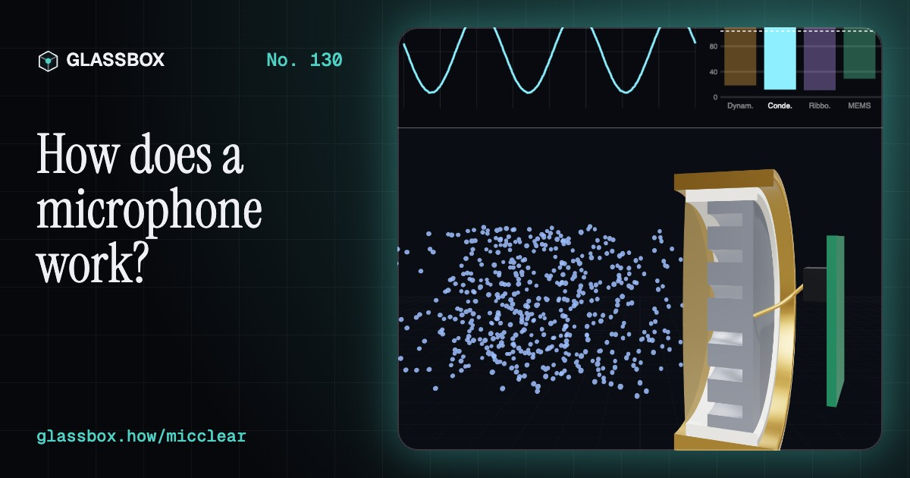
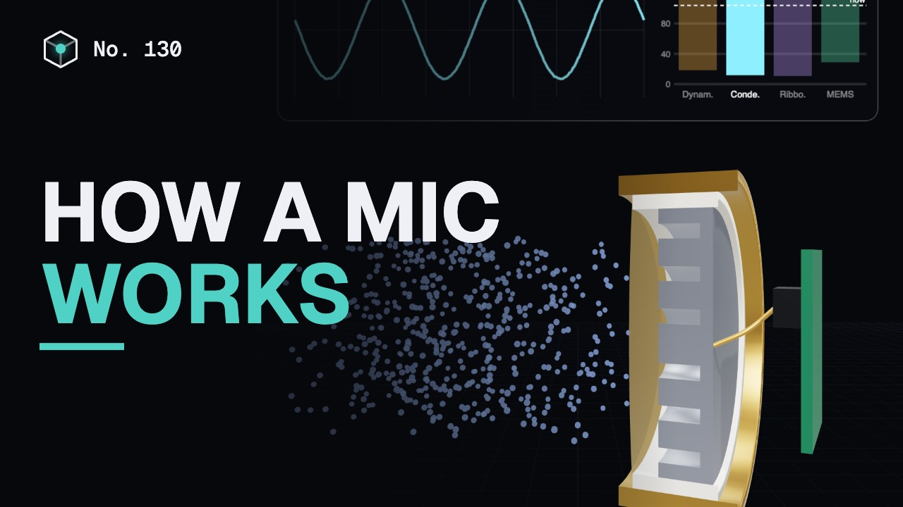
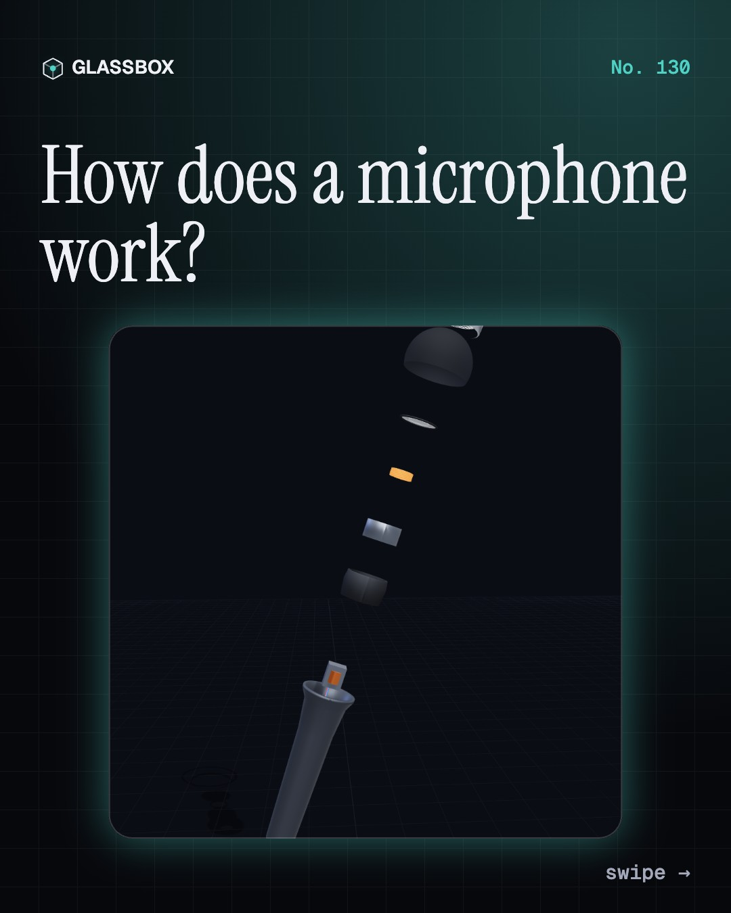
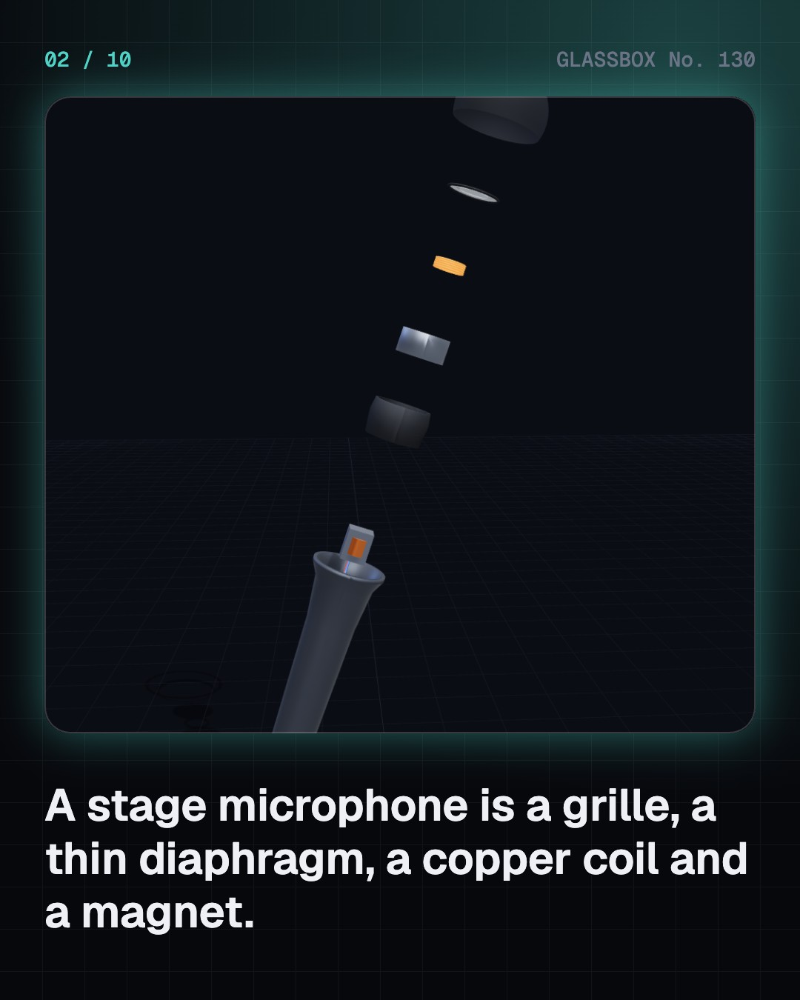
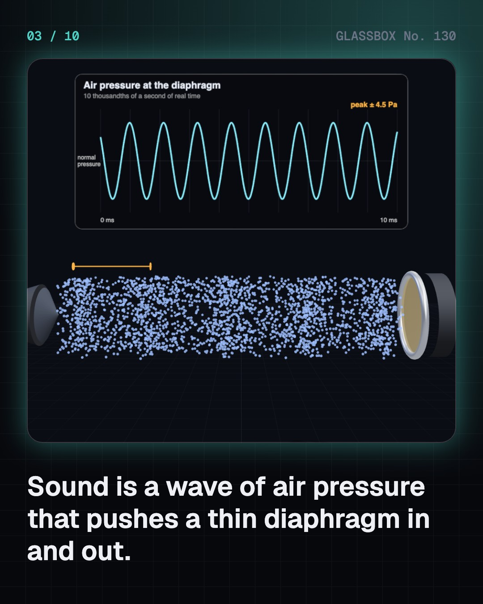
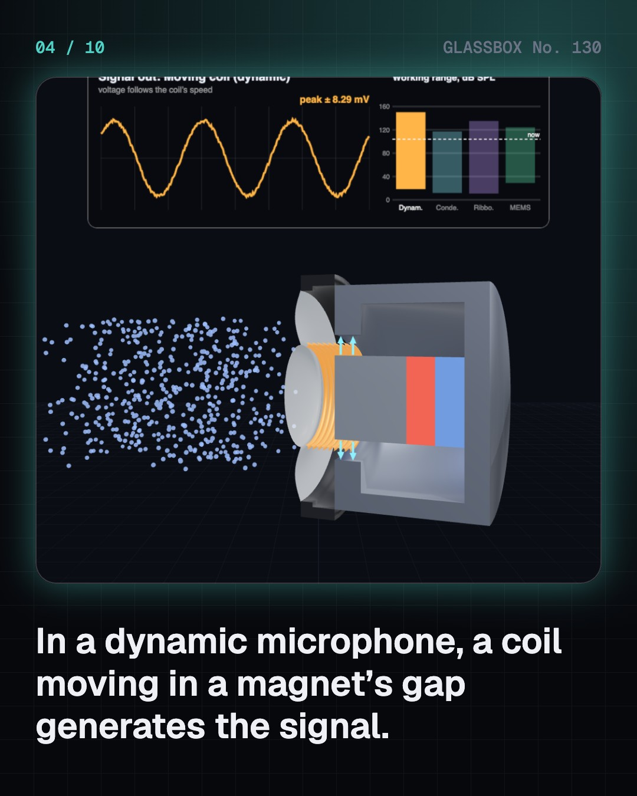

<!-- glassbox:start -->
<!-- Generated from glassbox.json by the Glassbox hub (npm run readme -- micclear). Edit glassbox.json, not this block. -->
<p align="center"><a href="https://glassbox.how/e/micclear/"></a></p>

<h1 align="center">MicClear</h1>

<p align="center"><b>How does a microphone work?</b><br>Your voice shoves a skin thinner than a hair, and a coil, a charged film or a chip of silicon turns that shiver into a few thousandths of a volt. Take a microphone apart in 3D, walk round it, and make it howl.</p>

<p align="center"><a href="https://glassbox.how/micclear/"><b>▶ Play with it</b></a> &nbsp;·&nbsp; <a href="https://glassbox.how/e/micclear/">Read the 60-second explainer</a> &nbsp;·&nbsp; <a href="https://glassbox.how/micclear/glassbox/reel.mp4">Watch the 40-second video</a></p>

<p align="center">
  <a href="https://glassbox.how/e/micclear/"></a>
  <a href="https://glassbox.how/e/micclear/"></a>
  <a href="LICENSE"></a>
  <a href="LICENSE-CONTENT.md"></a>
  <a href="#privacy"></a>
</p>

## In 60 seconds

1. **A grille, a diaphragm, a coil and a magnet.** A stage microphone is a tiny generator. Behind the steel ball and a layer of foam sits a plastic dome thinner than a hair, with a coil of fine copper wire glued to it. The coil hangs in a magnet's gap. A transformer and three pins carry the signal away.
2. **Sound is pressure, and the diaphragm rides it.** Sound is a wave of air pressure moving at 343 metres a second. Loud speech changes the pressure by less than one part in a hundred thousand, and each bit of air only shivers by about a thousandth of a millimetre. That is enough to push a light diaphragm in and out.
3. **Four ways to make a voltage.** A dynamic moves a coil in a magnetic field. A ribbon does the same with a strip of foil. A condenser is a charged film next to a metal plate: the gap changes, so the voltage changes, and it needs power. A MEMS microphone is a condenser etched in silicon, a few millimetres long, and every phone has several.
4. **The shape of its hearing.** Seal the back of a capsule and it hears all round. Open both sides and it hears front and back but not the sides. Mix the two and you get the heart-shaped cardioid that is deaf behind. A shotgun adds a slotted tube. Get close to a directional microphone and the bass swells.
5. **A whisper down a noisy cable.** A microphone gives a few millivolts, so a preamp must boost it hundreds of times. A balanced cable sends the signal twice, one copy upside down. Hum lands equally on both wires and cancels when they are subtracted. The same wires carry 48 volts of phantom power to condenser microphones.
6. **Numbers, and the howl.** A converter measures the signal 48,000 times a second and stores each measurement as a number. Too few bits sound gritty, too high a tone turns into a false one, and too big a signal clips. And a microphone that hears its own loudspeaker makes a loop: past the tipping point it howls.

## Words worth knowing

| Term | Meaning |
|---|---|
| **Transducer** | A device that turns one kind of energy into another. A microphone turns sound into an electrical signal. |
| **Diaphragm** | The thin, light skin in a microphone that sound pushes back and forth. |
| **Dynamic microphone** | A microphone that makes its voltage with a coil moving in a magnet's field. It needs no power. |
| **Condenser microphone** | A microphone whose diaphragm is one plate of a charged capacitor. It needs power, usually 48 volts. |
| **MEMS microphone** | A condenser microphone etched out of silicon, a few millimetres long, with its amplifier in the same package. |
| **Sensitivity** | How many millivolts a microphone gives for one pascal of sound pressure (94 dB SPL). |
| **Polar pattern** | A map of how well a microphone hears from each direction: omni, cardioid, figure-8 and others. |
| **Balanced line** | Two signal wires carrying opposite copies of the signal, so that hum picked up on the way can be subtracted out. |
| **Sample rate** | How many times a second a converter measures the signal. It can capture tones up to half that number. |

## A short history

**About 170 years from a pig's bristle scratching soot to the four tiny silicon microphones inside your phone.**

- **1876** · ‘Mr. Watson, come here’ (Alexander Graham Bell and Thomas Watson; Elisha Gray, Boston, USA)
- **1878** · The carbon microphone gets its name (David Edward Hughes, London, England)
- **1916** · The condenser microphone (Edward C. Wente, Western Electric, New York, USA)
- **1931** · RCA's ribbon microphones (Harry F. Olson and Les Anderson, RCA, Camden, New Jersey, USA)
- **1939** · The Unidyne hears one way (Benjamin Bauer, Shure Brothers, Chicago, USA)
- **1947** · The Neumann U 47 (Georg Neumann GmbH, Berlin, Germany)
- **1962** · The electret: a charge that stays (Gerhard Sessler and James West, Bell Laboratories, New Jersey, USA)
- **1966** · The SM57 and SM58 (Ernie Seeler, Shure, Illinois, USA)

The full story, with 30 moments, charts, people and 55 sources: [glassbox.how/e/micclear/history](https://glassbox.how/e/micclear/history/). The data lives in [`history.json`](history.json).

## Video and slides

Made with the Glassbox studio from this box's storyboard (`window.glassbox.director`). Free to reuse under CC BY 4.0.

<a href="https://glassbox.how/micclear/glassbox/video.mp4"></a>

<p><a href="glassbox/slide-1.jpg"></a> <a href="glassbox/slide-2.jpg"></a> <a href="glassbox/slide-3.jpg"></a> <a href="glassbox/slide-4.jpg"></a></p>

| File | What | Size |
|---|---|---|
| [`glassbox/reel.mp4`](https://glassbox.how/micclear/glassbox/reel.mp4) | Reel / Short, with captions and soundtrack | 1080×1920 |
| [`glassbox/video.mp4`](https://glassbox.how/micclear/glassbox/video.mp4) | YouTube video, with captions and soundtrack | 1920×1080 |
| `glassbox/slide-1…10.jpg` | Instagram carousel | 1080×1350 |
| `glassbox/thumb.jpg` | YouTube thumbnail | 1280×720 |
| `glassbox/cover.jpg` | Share card and repo social preview | 1200×630 |
| [`glassbox/history-reel.mp4`](https://glassbox.how/micclear/glassbox/history-reel.mp4) | “History in 10 moments” Reel / Short | 1080×1920 |
| `glassbox/history-slide-*.jpg` | History carousel | 1080×1350 |
| `glassbox/post.json` | Post copy and schedule used by the publish kit | |

## Privacy

This box has no accounts and no ads, and it ships its own fonts and libraries. When you run it yourself it sends nothing anywhere. On glassbox.how, the site's `/bar.js` also loads Glassbox's analytics: **Google Analytics** to count visits (it asks first in the EU, UK and Switzerland, and stays off when your browser sends Global Privacy Control or Do Not Track) and **ClickTrust** to detect bots.

It remembers a few things **in your own browser only**, and never sends them anywhere:

| Browser storage key | What it holds |
|---|---|
| `micclear.v1` | Which chapters you have opened, your best quiz scores, and sound on or off. |

Exactly what each one sees is at [glassbox.how/privacy](https://glassbox.how/privacy/).

## Licences

- **Code:** [MIT](LICENSE). Use it, change it, ship it.
- **Explanations, text, images and videos** (`glassbox.json`, `glassbox/`): [CC BY 4.0](LICENSE-CONTENT.md). Credit “Glassbox, glassbox.how/e/micclear”.
- **Third-party parts** keep their own licences: [three.js](https://threejs.org) (MIT), [Geist, Instrument Serif](https://openfontlicense.org) (SIL OFL 1.1).
- The Glassbox name and logo aren't covered by either licence. See the [terms](https://glassbox.how/terms/).

Found a mistake? [Open an issue](https://github.com/bdeeps/micclear/issues). Corrections happen in public.
<!-- glassbox:end -->

## Run it

It's plain HTML, CSS and JavaScript. No build step and no dependencies. Run locally, it contacts no other website.

```bash
python3 -m http.server 8000
```

Three.js and the fonts ship in `vendor/` and `fonts/`, so it also works offline.

Then open http://localhost:8000.

## How it's built

| File | What |
|---|---|
| `index.html`, `css/app.css` | The page and its styles |
| `js/app.js`, `js/stage.js`, `js/ui.js`, `js/kit.js` | The shared Glassbox 3D engine: chapters, 3D stage, controls, quiz, video director |
| `js/chapters/*.js` | One file per chapter: the 3D model, controls, text, key terms, quiz and video scenes |
| `js/mic.js` | Shared physics and parts: sound levels, the four example microphones' published figures, polar patterns, the stage microphone model, cut-away helpers, chart boards and air particles |
| `glassbox.json` | Title, question, explainer beats, key terms, browser storage and credits shown on glassbox.how |
| `reel` in each chapter | The storyboard the Glassbox studio records into short videos |
| `glassbox/` | The published video, slides, thumbnail and post copy |
| `fonts/`, `vendor/three/` | Self-hosted Geist and Instrument Serif (SIL OFL 1.1) and three.js (MIT) |
